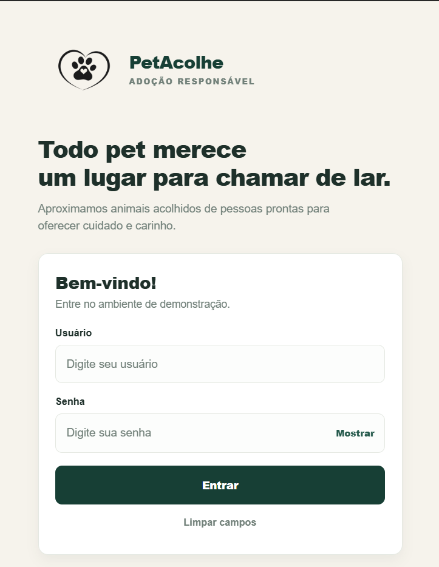
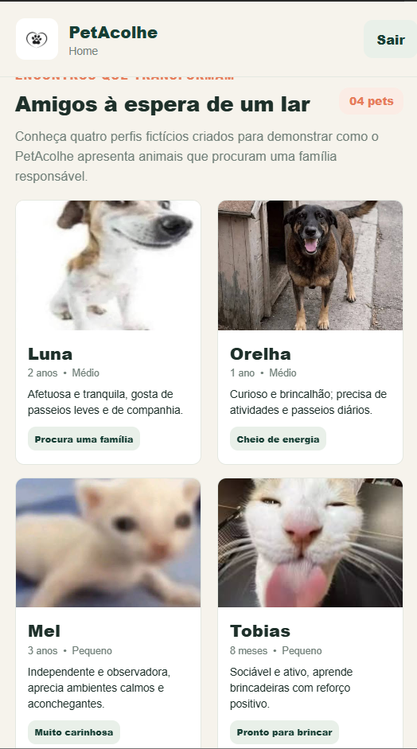
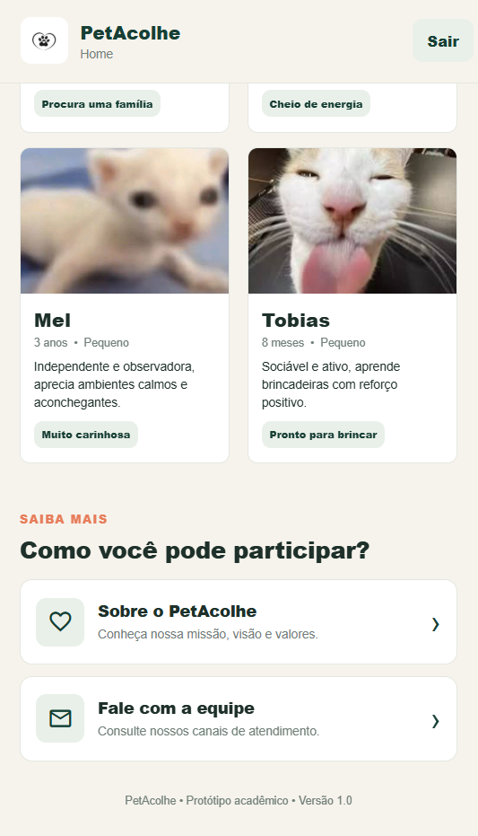
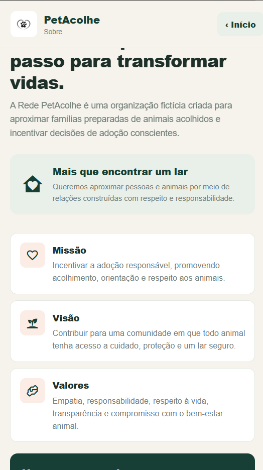
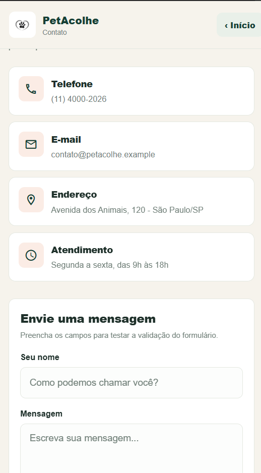

# PetAcolhe

**Aluno:** Matheus Bertelli  
**Aplicação:** PetAcolhe

## Descrição

O PetAcolhe é um protótipo mobile com foco na adoção responsável de animais. A aplicação demonstra um login simulado e a navegação entre as telas Home, Sobre e Contato.

## Tecnologia/framework

- React Native
- Expo SDK 54
- JavaScript
- `StyleSheet` para estilização

## Como executar

**Expo Snack:** acesse https://snack.expo.dev/, abra ou crie o projeto e importe os arquivos mantendo a estrutura de pastas e a pasta `assets`.

**Execução local:** com Node.js e npm instalados, execute na pasta do projeto:

```bash
npm install
npx expo start
```

## Credenciais para teste

- **Usuário:** `fatecano`
- **Senha:** `1234`

O login é apenas demonstrativo; não utiliza autenticação externa nem armazena credenciais de forma persistente.

## Estrutura resumida dos diretórios

```text
petacolhe/
├── App.js
├── index.js
├── app.json
├── package.json
├── assets/          # Logo e imagens
└── src/
    ├── components/ # Componentes reutilizáveis e Toolbar
    ├── data/       # Dados de demonstração e credenciais
    ├── navigation/ # Navegação entre telas
    ├── pages/      # Login, Home, Sobre e Contato
    └── styles/     # Cores, tipografia e estilos
```

## Funcionalidades implementadas

- Login com validação de campos e credenciais de demonstração.
- Campo de senha com caracteres ocultos.
- Navegação entre Login, Home, Sobre e Contato.
- Toolbar com título e opções de navegação adequadas à tela.
- Informações institucionais e de contato fictícias.
- Formulário de contato com validação local.
- Uso de imagens locais, ícones vetoriais e estilos compartilhados.

## Capturas de tela

### Login
<p align="center">
  
</p>

### Home
<p align="center">
  
</p>
<p align="center">
  
</p>


### Sobre
<p align="center">
  
</p>

### Contato
<p align="center">
  
</p>